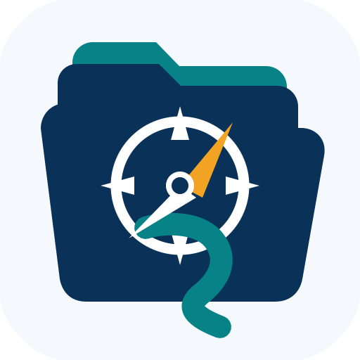

<div align="center">



# ArkivPiloten 📄➡️🗂️

**PDF Sorter 1.4.14 — exact saved support-word matches can move automatically; all other files wait for you.**
**PDF Sorter 1.4.14 — exakta stödordsträffar kan flyttas automatiskt; alla andra filer väntar på dig.**

Free · No ads · No tracking · Portable · Works offline
Gratis · Ingen reklam · Ingen spårning · Portabel · Fungerar offline

[**🇬🇧 English**](#english) · [**🇸🇪 Svenska**](#svenska) · [**❤️ Donate / Donera**](#support)

</div>

---

<a name="english"></a>

# 🇬🇧 English

## What is ArkivPiloten?

ArkivPiloten watches one or more **inbox folders**, reads every new PDF, and suggests which company or project it belongs to. A file moves automatically only when one saved support word or phrase matches literally as a whole word in the PDF text, and exactly one category owns such a match. Every other file stays in the inbox for your review.

It recognises senders by organisation number, VAT number, bankgiro, domain and company name, reads scanned documents with OCR, and **learns only from support words you choose and save**. Learned scores, fuzzy/partial matches and OCR-noise tolerance can suggest a destination but cannot authorize a move; rescans can move a file only when the same exact-match rule is met. Matching is case-insensitive and ignores repeated whitespace; punctuation and the spelling inside the full word or phrase must match exactly. Everything runs locally — no cloud, no account, no network calls for sorting.

> **Strict automatic rule.** Only a literal saved whole-word/phrase match that identifies a single category can move automatically. If there is no exact match, categories conflict, or the match is learned-only, partial, fuzzy, or OCR-tolerant, the file stays for review. The same rule applies during watching and rescanning.

### How a decision is made

| Result | Meaning | What happens |
|---|---|---|
| ✅ **Exact match** | One saved whole word/phrase appears literally in the PDF text and identifies one category | The file can move automatically to that category |
| 💡 **Suggestion** | Scores, learned matches, partial/flexible matches, or conflicting exact matches | The file stays in the inbox for your review; learned scores never trigger a move |
| ⚠️ **Error** | The file could not be read | The error is logged and the file is left untouched |

## Features

- 🧭 **Clearer design** — a branded header, highlighted three-step Start screen, compact cards and clearly ordered tabs keep everyday actions separate from advanced tools
- 📥 **Watched folders + review queue** — only an exact, unique saved support-word match can move automatically; every other PDF stays in the review queue
- 🎯 **Zone-weighted matching** — letterhead, footer and sender zones weigh more than body text, plus multi-page matching; an organisation-number support word can auto-move only when its exact spelling is saved and uniquely identifies one category
- 🧠 **User-controlled learning** — suggested support words are never preselected or saved automatically; you choose which words to save. The learned model ranks suggestions but never authorizes a move
- 🔐 **Exact-match safety** — automatic moves require a literal whole-word/phrase match in PDF text, a unique category, and non-recipient evidence; partial, fuzzy, OCR-denoised, filename-only, or learned-only matches require review
- 🔍 **OCR for scanned PDFs** (Tesseract), including logos in letterheads of otherwise text-based files
- 💡 **Clearer review dialog (1.4.14)** — file details, keyword suggestions and destination are grouped into clean cards. The existing-folder field accepts free text and filters the dropdown as you type; choose a match with Enter. The primary “Save & move” action is easy to spot.
- 💡 **Review controls** — see up to 25 support-word suggestions per PDF in a dedicated scrollable list; each shows its type and match count, while a bar indicates relative relevance. Suggestions are never selected or saved automatically. Choose words yourself, select a category and optional subfolder, and confirm. Kategorier has clearly separated actions to clear keywords while keeping categories, or remove all categories and keywords. Removing all categories creates a rules backup and enables Undo; the empty-state panel offers create/import shortcuts.
- ↩️ **Never destructive** — files are never overwritten (name clashes become `invoice (2).pdf`), and every move can be undone
- 🎨 **One shared app icon** — the new transparent 512px archive/checkmark mark is the source for windows/dialogs, taskbar, tray, shortcuts, macOS app bundle and the multi-size Windows `.ico`.
- 🧰 **Tray icon, autostart, single instance** — a manual launch opens the window; OS autostart starts in the tray. Windows autostart runs `pythonw.exe pdfsorter.py --tray` directly (not the `.pyw` file association), so the app branding replaces Python’s generic icon. Closing/minimizing sends the app to the tray while idle, but the window stays visible during sorting so duplicate prompts cannot get hidden.
- 🪵 **Session logging** in `logs/`; yesterday’s session logs are archived, while stable error codes remain in `logs/felkoder.log` until resolved. Mark one resolved with `python pdfsorter.py --mark-felkod-atgardad CODE`; its history is preserved. Detailed errors are also collected in `logs/fel-samlat.log`
- 🎒 **Portable by default** — settings, rules, history, logs, cache, icons, backups, updates and temp files live in subfolders of the app folder (`json/`, `logs/`, …). If the app folder is read-only (e.g. `/Applications` or `/opt`), data moves to the standard per-user folder instead; override with `PDFSORTER_HOME`
- 🧹 **Smart cache cleanup** — runs every 24 hours; removes cache unused for 30 days and the oldest entries above 1,500 files / 512 MB. Corrupt entries are discarded when read. A manual “Clean cache now” action is available under Settings → Cache and storage. Only regenerable PDF text-cache files are touched.
- 🧭 **AI report in one click (1.4.13)** — every error, warning and Tk callback exception collected into one compact block, ready to paste into an AI chat or a bug report. The same error from memory, the session log and `errors.log` is merged into one row with a count; only the tail of each log is read, so the report is ready in well under a second even with tens of megabytes of logs, and it says plainly if a log was only read in part. Tk callback exceptions are now captured even when the app runs without a console (`pythonw`). GUI: *Help → Copy AI report*, or `--ai-rapport` (add `--djup` to read the logs in full)
- 🔄 **Auto-update from GitHub Releases (1.4.0)** — and **only** from Releases: no branch is ever used as a source. The release carries a commit ID and SHA-256 manifest for shipped files, so the app detects a rebuilt release even when its version number is unchanged; legacy releases are compared from a checksum-verified ZIP. Installation verifies `SHA256SUMS.txt`, updates only app files with backup, compile check and rollback, then updates Python packages; your data is never touched. If GitHub's API is unreachable nothing is offered. On by default (Help → *Search for updates*, right-click the tray icon → *Search for updates*, or `--update`)
- 🚀 **Autostart on Windows/macOS/Linux (1.3.0)** — registry with Startup-folder fallback (Windows), LaunchAgent (macOS), XDG (Linux); self-healing sync at every start, verified after writing
- ❤️ **Donation view in the app** (Help → Support the project) with SV/EN toggle and a verified Swish QR code

## Quick start (Windows)

1. Double-click **`ArkivPiloten - Installera senaste Python och starta.bat`**
   — at ordinary launches it reuses installed Python without checking online; if none exists, it installs the latest stable version. Required add-ons are bootstrapped once, then a Windows scheduled task checks and updates Python and its packages weekly on Monday at 08:00 (a missed run starts when the PC is available again). Patch updates reuse the same installation; a new major/minor series may be installed alongside it. Packages use the selected shared Python environment, so other programs using that interpreter may also be affected. The launcher also checks/installs Tesseract OCR (best effort), runs the detailed status check only during first-time package setup, asks about autostart (default yes), and starts the app.
2. Done. The app starts without a console window, and will start with Windows minimized to the tray on future logins.

### Manual install

```bat
pip install -r requirements.txt
pythonw pdfsorter.pyw
```

Or start the GUI directly with `python pdfsorter.py` (no arguments opens the graphical interface). On Windows, if this starts with `python.exe`, the GUI automatically hands off to `pythonw.exe` (or uses `CREATE_NO_WINDOW` as a fallback), so no console window is left behind. CLI commands such as `--check` continue to use the console.

### Upgrading from the old 1.0.0 / 1.1.0

Those versions looked for updates in the `main` branch instead of GitHub Releases, so they can never see a release and will always claim to be up to date. Run the one-time upgrader once — it fetches the latest release, verifies the checksum and replaces only the program files (your rules, settings and history are untouched):

```bat
uppgradera-arkivpiloten.bat
```

```bash
bash uppgradera-arkivpiloten.sh          # macOS / Linux
python3 tools/install_latest.py --root . # or run the script directly
```

Download the launcher anywhere and double-click it — it finds the app folder on its own (Desktop, Documents, Downloads, OneDrive, `%LOCALAPPDATA%\Programs`), or drag the app folder onto it. It also detects changed release-file hashes when the version number is unchanged. After that the app updates itself from Releases, as described above. Add `--dry-run` to see what would happen first.

## Quick start (macOS & Linux)

```bash
./install.sh              # venv + requirements.txt, autostart on by default
./install.sh --no-autostart # explicitly turn autostart off
./install.sh --uninstall  # remove autostart + shortcuts, keep your data
```

`install.sh` installs everything in a local `.venv` (no sudo), checks Tkinter and Tesseract with per-distro hints, creates a desktop/app-menu shortcut, and builds a real `~/Applications/ArkivPiloten.app` on macOS. Autostart uses a LaunchAgent on macOS and XDG `autostart/*.desktop` on Linux (KDE, GNOME, XFCE, …) — both are verified after writing and repaired on the next start if they break.

> Tray on Linux needs a StatusNotifier host. GNOME requires the *AppIndicator* extension; without it the app still opens its window instead of hiding it.

> **Good to know:** every Python dependency is optional — the app starts anyway and tells you in the status bar what is missing. For the best reading quality install the full stack, and note that OCR also requires the **Tesseract** system program:
>
> ```bat
> pip install pymupdf pypdf pystray pillow pytesseract
> ```

## Command line (optional)

```bat
python pdfsorter.py --status                                   :: which PDF engines & add-ons were found
python pdfsorter.py -i INBOX -o OUTBOX --no-ask                :: sort once, never ask
python pdfsorter.py -i INBOX -o OUTBOX --dry-run --verbose     :: test run, change nothing on disk
python pdfsorter.py --watch                                    :: keep watching the inbox
python pdfsorter.py --install-autostart                        :: start with Windows
python pdfsorter.py --make-shortcut                            :: create a desktop shortcut
python pdfsorter.py --diagnostik                               :: full diagnostics bundle for support
python pdfsorter.py --version                                  :: show version
python pdfsorter.py --check                                    :: built-in self-test (imports, matching, icon)
python pdfsorter.py --export-archive FOLDER                     :: export a year archive (open folders + HTML index, no zip)
python pdfsorter.py --lookup-orgnr 556677-8899                   :: look up a company name by org. number
python pdfsorter.py --check-update                             :: is a newer version available on GitHub?
python pdfsorter.py --update                                   :: update app (in its own folder) + Python packages
python pdfsorter.py --install-packages                         :: install/update all Python add-ons
```

Run `python pdfsorter.py --help` for all options (`--copy`, `--exclude`, `--json`, `--report`, …).

## Project structure

```text
ArkivPiloten/
├── ArkivPiloten - Installera senaste Python och starta.bat   the only launcher you need (Windows)
├── install.sh              installer for macOS & Linux (venv, shortcut, autostart)
├── uppgradera-arkivpiloten.bat / .sh   one-time upgrade from 1.0.0/1.1.0
├── tests/                  pytest suite (autostart per OS, updater, config dir)
├── tools/build_release.py  builds ArkivPiloten.zip + SHA256SUMS.txt
├── .github/workflows/      CI (tests/lint) + automatic release publishing
├── pyproject.toml          pytest/ruff settings
├── pdfsorter.py            main program (GUI, engine, matching)
├── pdfsorter.pyw           console-free launcher
├── pdfsorter_data.py       rules, history, locking, atomic writes
├── pdfsorter_read.py       text extraction, OCR, keyword suggestions
├── pdfsorter_system.py     icon, autostart, tray, logs, crash reports
├── pdfsorter_theme.py      light/dark/high-contrast themes, HiDPI
├── Stöd ArkivPiloten.html  donation page (SV/EN, Swish QR)
├── swish_qr.png            Swish QR (0721817177), verified
├── ArkivPiloten.ico/.png   app icon (used everywhere)
├── desktop.ini             folder icon in Explorer
└── PDFSORTER_SPEC.md       requirements specification (source of truth)
```

The five Python files must stay in the same folder. If `pdfsorter_system.py` or `pdfsorter_theme.py` is missing the app still starts (without tray/autostart, or with Tkinter's default grey look) — `pdfsorter_data.py` and `pdfsorter_read.py` are required.

## Releases & auto-update (maintainers)

The app updates from the **latest GitHub Release**, never from a branch. Each release must therefore contain `ArkivPiloten.zip` and `SHA256SUMS.txt`:

```bash
python tools/build_release.py --bump patch   # bumps all five modules + README
git commit -am "Release 1.4.1" && git push
```

`.github/workflows/release.yml` builds the package and publishes/refreshes the current release automatically for every branch push and every `v*` tag. Release assets stay on the app's version; the updater compares the release commit and per-file SHA-256 hashes, so it can detect same-version rebuilds too.

**Branch policy:** no merge commits. Work on a branch and publish with a fast-forward push or a tag/release — never `gh pr merge`.

## Privacy & safety

- 🔒 **Everything happens locally.** Sorting makes no network calls and there is no tracking. (Only the Windows installer — Python/pip downloads — and the donation buttons open external sites.)
- 🛡️ **Your files are safe:** never overwritten, moves can be undone, and unreadable files are left exactly where they were.
- 💾 **Your data stays yours:** rules, settings and history are plain JSON in the app folder — open them, back them up, take them with you.

## Tests & diagnostics

```bat
python pdfsorter.py --check
python pdfsorter.py --status
python pdfsorter_data.py
python pdfsorter_read.py --check
python pdfsorter_system.py --check

# utvecklartester (Linux/macOS, inga riktiga autostartsposter rörs)
pip install -r requirements-dev.txt
python -m pytest
```

Found a bug? Run `python pdfsorter.py --ai-rapport` (or *Copy AI report* in the app) and paste the block into the report — it lists every error with a stable fingerprint, a count, the code location and the traceback, merged from memory and the logs. For quick manual inspection, errors are also collected across sessions in `logs/fel-samlat.log`. `--diagnostik` adds versions, settings and engine status. Neither contains document content, and the AI report redacts your user name and home folder.

---

<a name="support"></a>

## ❤️ Support ArkivPiloten — Donate

**Yes — donations are very welcome!** ArkivPiloten is free, with no ads and no paywall, and it will stay that way. Donations are completely voluntary and go straight to what makes a difference: better matching, faster OCR, self-healing logs and new features. You support a small Swedish indie developer — not a company. 💙

| Tier | | What it does |
|---|---|---|
| ☕ **A coffee — 39 SEK** | | A small thanks that fuels evening coding |
| 📚 **Book friend — 99 SEK** *(most picked)* | | Covers a month of maintenance and test files |
| 🌟 **Hero — 299 SEK** | | Carries the project further; your idea jumps the queue |

**Any amount is appreciated** — one-off or monthly, no commitment:

- 💙 **PayPal:** [paypal.me/Rickard3dPrint](https://paypal.me/Rickard3dPrint)
- ☕ **Ko-fi:** [ko-fi.com/tokke2](https://ko-fi.com/tokke2) *(monthly giving available, cancel anytime)*
- 📱 **Swish (Sweden):** **0721817177** — scan the QR code below with the Swish app

<div align="center">

</div>

You can also donate from inside the app via **Help → Support the project 💖**, or open the donation page [`Stöd ArkivPiloten.html`](St%C3%B6d%20ArkivPiloten.html) included in this folder (SV/EN toggle included). Payments go directly through PayPal, Ko-fi or Swish over HTTPS — neither the app nor the developer ever sees your card number, and your receipt comes straight from the payment provider.

*Thank you for keeping ArkivPiloten free for everyone! ✨*

---

<div align="center">

[🇬🇧 English](#english) · [🇸🇪 Svenska ↓](#svenska)

</div>

<a name="svenska"></a>

# 🇸🇪 Svenska

## Vad är ArkivPiloten?

ArkivPiloten bevakar en eller flera **inmappar**, läser varje ny PDF och föreslår vilket företag eller projekt den hör till. En fil flyttas automatiskt bara om ett sparat stödord eller en fras matchar bokstavligt som helt ord i PDF-texten och exakt en kategori äger träffen. Alla andra filer ligger kvar för granskning.

Den känner igen avsändare på organisationsnummer, VAT-nummer, bankgiro, domän och firmanamn, läser skannade PDF:er med OCR och **lär bara in stödord som du själv väljer och sparar**. Inlärda poäng, delträffar och OCR-tolerans kan föreslå en mapp men aldrig ge flytträtt; en omskanning kan flytta en fil bara när samma exakta stödordsregel är uppfylld. Matchningen är skiftlägesokänslig och slår ihop upprepade blanksteg; skiljetecken och stavningen inne i hela ordet/frasen måste annars vara identiska. Allt sker lokalt — ingen molntjänst, inget konto, inga nätverksanrop för sorteringen.

> **Strikt regel för automatisk flytt.** Bara en bokstavlig sparad helords-/frasträff som pekar ut en enda kategori kan flyttas automatiskt. Om exakt träff saknas, kategorier krockar eller matchningen bara bygger på inlärning, delord, fuzzy-matchning eller OCR-tolerans ligger filen kvar för granskning. Samma regel gäller bevakning och omskanning.

### Så fattas beslutet

| Resultat | Betydelse | Vad som händer |
|---|---|---|
| ✅ **Exakt träff** | Ett sparat helt ord/en fras finns bokstavligt i PDF-texten och pekar ut en kategori | Filen kan flyttas automatiskt till den kategorin |
| 💡 **Förslag** | Poäng, inlärning, delträffar eller motstridiga exakta träffar | Filen ligger kvar i inmappen för granskning; inlärda poäng flyttar aldrig |
| ⚠️ **Fel** | Filen kunde inte läsas | Felet loggas och filen lämnas orörd |

## Funktioner

- 🧭 **Tydligare design** — en gemensam varumärkesrad, markerade tre steg på startsidan, kompakta kort och tydlig flikordning skiljer vardagsåtgärder från avancerade verktyg
- 📥 **Bevakade mappar + granskningskö** — bara en exakt, unik stödordsträff kan flyttas automatiskt; alla andra PDF:er ligger kvar i granskningskön
- 🎯 **Zonviktad matchning** — brevhuvud, sidfot och avsändarzon väger tyngre än brödtext, plus flersidig matchning; ett org.nr-stödord får bara auto-flytta när exakt skrivsätt är sparat och pekar ut en kategori
- 🧠 **Användarstyrd inlärning** — stödordsförslag förbockas eller sparas aldrig automatiskt; du väljer vilka ord som ska sparas. Den inlärda modellen rangordnar förslag men ger aldrig flytträtt
- 🔐 **Lokal, återställningsbar inlärning** — modell och zonfunktioner sparas lokalt med atomisk skrivning och säkerhetskopia; historiken kan spelas upp igen efter återställning. Ingen molntjänst eller nätverksinlärning används
- 🔐 **Säker exaktmatchning** — automatisk flytt kräver bokstavlig helords-/frasträff i PDF-texten, en entydig kategori och bevis utanför mottagarblocket; delträffar, OCR-brus, filnamn och inlärning kräver granskning
- 🔍 **OCR för skannade PDF:er** (Tesseract), inklusive logotyper i brevhuvuden på i övrigt textbaserade filer
- 💡 **Tydligare granskningsruta (1.4.14)** — filinfo, stödordsförslag och målmapp ligger i rena, separata kort. Fältet för befintlig mapp tar fritext och filtrerar listan medan du skriver; Enter väljer en träff. Huvudknappen **Spara & flytta** är lätt att hitta.
- 💡 **Granskningskontroller** — förslag förbockas eller sparas inte åt dig; välj stödord, kategori och eventuell undermapp själv. Fliken Kategorier har en knapp för att rensa alla stödord. Mushjulet pausas medan kategorirullgardinen är öppen.
- ↩️ **Aldrig destruktiv** — filer skrivs aldrig över (namnkrockar blir `faktura (2).pdf`), och varje flytt går att ångra
- 🎨 **En gemensam appikon** — den nya transparenta 512px-ikonen med arkiv/checkmark är källa för fönster/dialoger, aktivitetsfält, systemfält, genvägar, macOS-appen och Windows-`.ico` i flera storlekar.
- 🧰 **Tray-ikon, autostart, enkelinstans** — appen startar alltid minimerad, i systemfältet om det kan visas säkert och annars i aktivitetsfältet. En andra start visar den redan öppna instansen. Windows-autostart kör `pythonw.exe pdfsorter.py --tray` direkt (inte `.pyw` via filassociation), så appens egen ikon används i stället för Pythons standardikon. Under sortering hålls fönstret synligt så att dubblettfrågor inte hamnar bakom systemfältet.
- 🪵 **Sessionsloggning** i `logs/`; gårdagens sessionsloggar arkiveras medan stabila felkoder ligger kvar i `logs/felkoder.log` tills de åtgärdats. Markera en felkod med `python pdfsorter.py --mark-felkod-atgardad KOD`; historiken bevaras. Detaljerade fel samlas också i `logs/fel-samlat.log`
- 🎒 **Portabelt som standard** — inställningar, regler, historik, loggar, cache, ikoner, säkerhetskopior, uppdateringar och tempfiler bor i appmappens undermappar (`json/`, `logs/`, …). Är appmappen skrivskyddad (t.ex. `/Applications` eller `/opt`) flyttas datan till användarens ordinarie datamapp i stället; `PDFSORTER_HOME` styr om
- 🧹 **Smart cacherensning** — körs var 24:e timme och tar bort cache som inte använts på 30 dagar samt äldsta poster över 1 500 filer / 512 MB. Skadade poster rensas när de läses. Manuell knapp finns under Inställningar → Cache och lagring. Bara återskapbar PDF-textcache påverkas.
- 🧭 **AI-rapport på ett klick (1.4.13)** — alla fel, varningar och Tk-callbackundantag samlade i ett kompakt block, klart att klistra in i en AI-chatt eller felanmälan. Samma fel från minnet, sessionsloggen och `errors.log` slås ihop till en rad med antal; bara svansen av varje logg läses, så rapporten är klar på under en sekund även med tiotalet megabyte loggar — och den säger rakt ut om en logg bara lästes delvis. Tk-callbackundantag fångas nu även när appen körs utan konsol (`pythonw`). I appen: *Hjälp → Kopiera AI-rapport (alla fel)*, eller `--ai-rapport` (lägg till `--djup` för att läsa hela loggarna)
- 🔄 **Autouppdatering från GitHub Releases (1.4.0)** — och **enbart** därifrån: ingen gren används någonsin som källa. Releasen innehåller commit-ID och SHA-256-manifest för programfilerna, så appen upptäcker även ombyggda releaser med samma versionsnummer; äldre releaser jämförs från en checksummeverifierad ZIP. Före installation verifieras `SHA256SUMS.txt`; bara appfiler uppdateras, med säkerhetskopia, kompileringstest och rollback. Användardata rörs inte. Appen söker **tyst två gånger per dygn** och startar om sig själv när en verifierad uppdatering installerats. På som standard (Hjälp → *Sök efter uppdateringar*, högerklicka på tray-ikonen → *Sök efter uppdateringar*, eller `--update`)
- 🚀 **Autostart på Windows/macOS/Linux (1.3.0)** — register med Startup-mapp som reserv (Windows), LaunchAgent (macOS), XDG (Linux); självläkande synk vid varje start, verifierad efter skrivning
- ❤️ **Donationsvy i appen** (Hjälp → Stöd projektet) med SV/EN-växel och verifierad Swish-QR

## Kom igång (Windows)

1. Dubbelklicka på **`ArkivPiloten - Installera senaste Python och starta.bat`**
   — vid vanliga starter återanvänder den installerad Python utan nätverkskontroll; saknas Python installeras senaste stabila version. Nödvändiga tillägg grundinstalleras en gång. Därefter kontrollerar och uppdaterar en schemalagd Windows-uppgift Python och dess paket varje måndag kl. 08:00; en missad körning startar när datorn och användarsessionen blir tillgängliga. Patchar återanvänder samma installation, medan en ny huvud-/underversion kan installeras bredvid. Paketen använder vald delad Python-miljö och kan därför påverka andra program som använder samma interpreter. Startfilen kontrollerar/installerar även Tesseract OCR (bästa försök), kör detaljerad statuskontroll bara vid första paketinstallationen, frågar om autostart (standard ja) och startar appen.
2. Klart. Appen startar utan konsolfönster och alltid minimerad; systemfältet används om det kan visas säkert, annars aktivitetsfältet. Vid framtida inloggningar startar appen också minimerad.

### Uppgradera från gamla 1.0.0 / 1.1.0

De versionerna letade uppdateringar i `main`-grenen i stället för i GitHub Releases, och kan därför aldrig se en release — de påstår alltid att de är uppdaterade. Kör engångsuppgraderingen en gång: den hämtar senaste releasen, kontrollerar summan och byter bara programfilerna (dina regler, inställningar och din historik rörs aldrig):

```bat
uppgradera-arkivpiloten.bat
```

```bash
bash uppgradera-arkivpiloten.sh          # macOS / Linux
python3 tools/install_latest.py --root . # eller kör skriptet direkt
```

Ladda ner launchern var du vill och dubbelklicka — den hittar appmappen själv (Skrivbord, Dokument, Hämtade filer, OneDrive, `%LOCALAPPDATA%\Programs`), och du kan också dra appmappen till filen. Den känner även av ändrade filhashar när versionsnumret är oförändrat. Efter det sköter appen sina uppdateringar själv via Releases, precis som beskrivits ovan. Lägg till `--dry-run` om du först vill se vad som skulle hända.

### Manuell installation

```bat
pip install -r requirements.txt
pythonw pdfsorter.pyw
```

Eller starta gränssnittet direkt med `python pdfsorter.py` (utan argument öppnas det grafiska gränssnittet).

## Kom igång (macOS & Linux)

```bash
./install.sh              # venv + requirements.txt, autostart på som standard
./install.sh --no-autostart # stäng av autostart uttryckligen
./install.sh --uninstall  # ta bort autostart + genvägar, behåll din data
```

`install.sh` installerar allt i en lokal `.venv` (inget sudo), kontrollerar Tkinter och Tesseract med tips per distribution, skapar genväg på skrivbordet/i appmenyn och bygger en riktig `~/Applications/ArkivPiloten.app` på macOS. Autostarten använder LaunchAgent på macOS och XDG `autostart/*.desktop` på Linux (KDE, GNOME, XFCE, …) — båda verifieras efter skrivning och lagas vid nästa start om de går sönder.

> Systemfältet på Linux kräver en StatusNotifier-värd. På GNOME behövs tillägget *AppIndicator*; utan det öppnar appen fönstret i stället för att gömma sig.

> **Bra att veta:** alla Python-beroenden är valfria — appen startar ändå och talar om i statusraden vad som saknas. För bästa läskvalitet installerar du hela stacken, och tänk på att OCR dessutom kräver systemprogrammet **Tesseract**:
>
> ```bat
> pip install pymupdf pypdf pystray pillow pytesseract
> ```

## Kommandorad (valfritt)

```bat
python pdfsorter.py --status                                   :: vilka PDF-motorer & tillägg som hittats
python pdfsorter.py -i INMAPP -o UTMAPP --no-ask               :: sortera en gång, fråga aldrig
python pdfsorter.py -i INMAPP -o UTMAPP --dry-run --verbose    :: testkör, ändra inget på disk
python pdfsorter.py --watch                                    :: bevaka inmappen kontinuerligt
python pdfsorter.py --install-autostart                        :: starta med Windows
python pdfsorter.py --make-shortcut                            :: skapa genväg på skrivbordet
python pdfsorter.py --diagnostik                               :: komplett diagnostikpaket för support
python pdfsorter.py --ai-rapport                               :: alla fel i ett block, klart att klistra in i en AI-chatt
python pdfsorter.py --ai-rapport --djup                        :: ...men läser hela loggarna i stället för svansen
python pdfsorter.py --version                                  :: visa version
python pdfsorter.py --check                                    :: inbyggt självtest (importer, matchning, ikon)
python pdfsorter.py --export-archive MAPP                       :: exportera årsarkiv (öppna mappar + HTML-index, ej zip)
python pdfsorter.py --lookup-orgnr 556677-8899                   :: slå upp firmanamn för ett org.nr
python pdfsorter.py --check-update                             :: finns nyare version på GitHub?
python pdfsorter.py --update                                   :: uppdatera appen (i appmappen) + Python-paketen
python pdfsorter.py --install-packages                         :: installera/uppdatera alla Python-tillägg
```

Kör `python pdfsorter.py --help` för alla växlar (`--copy`, `--exclude`, `--json`, `--report`, …).

## Projektstruktur

```text
ArkivPiloten/
├── ArkivPiloten - Installera senaste Python och starta.bat   enda startfilen du behöver (Windows)
├── install.sh              installation för macOS & Linux (venv, genväg, autostart)
├── tests/                  pytest-svit (autostart per OS, uppdateraren, datamapp)
├── tools/build_release.py  bygger ArkivPiloten.zip + SHA256SUMS.txt
├── .github/workflows/      CI (tester/lint) + automatisk release-publicering
├── pyproject.toml          inställningar för pytest/ruff
├── pdfsorter.py            huvudprogram (GUI, motor, matchning)
├── pdfsorter.pyw           konsolfri start
├── pdfsorter_data.py       regler, historik, lås, atomisk skrivning
├── pdfsorter_read.py       textextraktion, OCR, stödordsförslag
├── pdfsorter_system.py     ikon, autostart, tray, loggar, kraschrapporter
├── pdfsorter_theme.py      ljust/mörkt/högkontrast-tema, HiDPI
├── Stöd ArkivPiloten.html  donationssida (SV/EN, Swish-QR)
├── swish_qr.png            Swish-QR (0721817177), verifierad
├── ArkivPiloten.ico/.png   appikonen (används överallt)
├── desktop.ini             mappikon i Utforskaren
└── PDFSORTER_SPEC.md       kravspecifikation (source of truth)
```

De fem Python-filerna måste ligga i samma mapp. Saknas `pdfsorter_system.py` eller `pdfsorter_theme.py` startar appen ändå (utan tray/autostart, respektive med Tkinters gråa standardutseende) — `pdfsorter_data.py` och `pdfsorter_read.py` är obligatoriska.

## Releaser & autouppdatering (underhåll)

Appen uppdaterar från **senaste GitHub-releasen**, aldrig från en gren. Varje release måste därför innehålla `ArkivPiloten.zip` och `SHA256SUMS.txt`:

```bash
python tools/build_release.py --bump patch   # höjer alla fem moduler + README
git commit -am "Release 1.4.1" && git push
```

`.github/workflows/release.yml` bygger paketet och publicerar/uppdaterar den aktuella releasen automatiskt vid push till valfri gren och varje `v*`-tagg. Release-filerna behåller appens versionsnummer; uppdateraren jämför release-commit och SHA-256 för varje fil och hittar därför även ombyggnader med samma versionsnummer.

**Grenpolicy:** inga merge-commits. Arbeta på en gren och publicera med fast-forward-push eller tagg/release — aldrig `gh pr merge`.

## Integritet & säkerhet

- 🔒 **Allt sker lokalt.** Sorteringen gör inga nätverksanrop och det finns ingen spårning. (Bara Windows-installeraren — Python-/pip-hämtningar — och donationsknapparna öppnar externa sidor.)
- 🛡️ **Dina filer är trygga:** de skrivs aldrig över, flyttar går att ångra, och oläsliga filer lämnas exakt där de låg.
- 💾 **Din data förblir din:** regler, inställningar och historik är vanlig JSON i appmappen — öppna dem, säkerhetskopiera dem, ta dem med dig.

## Test & diagnostik

```bat
python pdfsorter.py --check
python pdfsorter.py --status
python pdfsorter_data.py
python pdfsorter_read.py --check
python pdfsorter_system.py --check

# utvecklartester (Linux/macOS, inga riktiga autostartsposter rörs)
pip install -r requirements-dev.txt
python -m pytest
```

Hittat en bugg? Kör `python pdfsorter.py --ai-rapport` (eller *Kopiera AI-rapport* i appen) och klistra in blocket i felanmälan — det listar varje fel med ett stabilt fingeravtryck, antal, kodplats och spårning, sammanslaget från minnet och loggarna. För snabb manuell felsökning samlas fel från flera körningar även i `logs/fel-samlat.log`. `--diagnostik` lägger till versioner, inställningar och motorstatus. Inget av dem innehåller dokumentinnehåll, och AI-rapporten avidentifierar användarnamn och hemkatalog.

---

<a name="stod"></a>

## ❤️ Stöd ArkivPiloten — Donera

**Ja — donationer tas tacksamt emot!** ArkivPiloten är gratis, utan reklam och utan betalvägg, och så förblir det. Donationer är helt frivilliga och går direkt till det som märks: bättre matchning, snabbare OCR, självläkande loggar och nya funktioner. Du stödjer en liten svensk indie-utvecklare — inte ett bolag. 💙

| Nivå | | Vad den gör |
|---|---|---|
| ☕ **En kaffe — 39 kr** | | Ett litet tack som ger energi till kvällskodning |
| 📚 **Bokvän — 99 kr** *(mest vald)* | | Täcker en månads underhåll och testfiler |
| 🌟 **Hjälte — 299 kr** | | Bär projektet en extra bit; din idé hamnar högt i kön |

**Valfritt belopp går lika bra** — engångs eller månadsvis, ingen bindning:

- 💙 **PayPal:** [paypal.me/Rickard3dPrint](https://paypal.me/Rickard3dPrint)
- ☕ **Ko-fi:** [ko-fi.com/tokke2](https://ko-fi.com/tokke2) *(månadsgivande möjligt, avsluta när du vill)*
- 📱 **Swish:** **0721817177** — skanna QR-koden nedan med Swish-appen

<div align="center">

</div>

Du kan också donera inifrån appen via **Hjälp → Stöd projektet 💖**, eller öppna donationssidan [`Stöd ArkivPiloten.html`](St%C3%B6d%20ArkivPiloten.html) som ligger i den här mappen (SV/EN-växel finns). Betalningarna går direkt via PayPal, Ko-fi eller Swish över HTTPS — varken appen eller utvecklaren ser någonsin ditt kortnummer, och kvittot kommer direkt från betaltjänsten.

*Tack för att du håller ArkivPiloten gratis för alla! ✨*

---

<div align="center">

**ArkivPiloten 1.4.14** · © 2026 Rickard Längkvist · The app is — and will remain — free. · Appen är — och förblir — gratis.

[🇬🇧 Back to English ↑](#english) · [🇸🇪 Tillbaka till Svenska ↑](#svenska) · [❤️ Donate / Donera ↑](#support)

</div>
