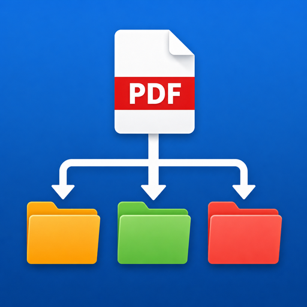

<div align="center">



# ArkivPiloten 📄➡️🗂️

**PDF Sorter 1.1.0 — your PDFs, sorted into the right folders. Automatically.**
**PDF Sorter 1.1.0 — dina PDF:er, sorterade i rätt mappar. Automatiskt.**

Free · No ads · No tracking · Portable · Works offline
Gratis · Ingen reklam · Ingen spårning · Portabel · Fungerar offline

[**🇬🇧 English**](#english) · [**🇸🇪 Svenska**](#svenska) · [**❤️ Donate / Donera**](#support)

</div>

---

<a name="english"></a>

# 🇬🇧 English

## What is ArkivPiloten?

ArkivPiloten watches one or more **inbox folders**, reads every new PDF, figures out which company or project it belongs to, and moves it to the right subfolder in your **outbox folder** — e.g. `Outbox/Pilkington/2025/`.

It recognises senders by organisation number, VAT number, bankgiro, domain and company name, reads scanned documents with OCR, and **learns from your decisions**: when it is unsure it asks you once, and similar files are then sorted automatically in the future. Everything runs locally on your computer — no cloud, no account, no network calls for sorting.

> **Cautious by design.** A file is only moved automatically when the evidence is strong. If ArkivPiloten is unsure, it asks instead — answering one question is always cheaper than hunting down a misfiled document.

### How a decision is made

| Result | Meaning | What happens |
|---|---|---|
| ✅ **Auto** | The evidence is strong enough | The file is moved right away |
| ❓ **Ask** | Unclear or weak evidence | The file goes to the review queue; you tick the keywords that belong to the right category, and the app learns from it |
| ⚠️ **Error** | The file could not be read | The error is logged and the file is left untouched |

## Features

- 📥 **Watched folders + automatic sorting** into `<category>/<year>`, using the document's own date for the year folder
- 🎯 **Zone-weighted matching** — letterhead, footer and sender zones weigh more than body text, plus multi-page matching; a proven organisation number always suffices on its own
- 🧠 **Self-learning classifier** — suggests and breaks deadlocks between rule-approved candidates after roughly 5 decisions per category; it never moves a file on its own
- 🔐 **Safer matching (1.2.0+)** — body-text-only mentions never auto-move a file on Normal and above: auto-sorting requires sender-zone, strong-ID or multi-page evidence, at least 12 characters of read text, and the exact analysed bytes are fingerprinted (SHA-256) and re-verified before any move
- 🔍 **OCR for scanned PDFs** (Tesseract), including logos in letterheads of otherwise text-based files
- 💡 **10 keyword suggestions per uncertain file** — tick the right ones in the review dialog and the file (and future lookalikes) sort themselves
- ↩️ **Never destructive** — files are never overwritten (name clashes become `invoice (2).pdf`), and every move can be undone
- 🧰 **Tray icon, autostart, single instance**, dark / light / high-contrast themes, HiDPI-aware
- 🪵 **Session logging** in `logs/` and a one-click diagnostics bundle (*Copy diagnostics*) for support
- 🎒 **Everything stays in the app folder (1.3.0)** — settings, rules, history, logs, cache, icons, backups, updates and temp files all live in subfolders of the app folder (`json/`, `logs/`, `cache/`, `icons/`, `backups/`, `updates/`, `temp/`); nothing is written to `%APPDATA%` or your home directory (override only via `PDFSORTER_HOME`)
- 🔄 **Auto-update from GitHub (1.3.0)** — checks for new versions, updates only the app's own files with backup + compile validation, then updates the Python packages; your data is never touched (Help tab → *Search for updates*, or `--update`)
- 🚀 **Autostart on Windows/macOS/Linux (1.3.0)** — registry with Startup-folder fallback (Windows), LaunchAgent (macOS), XDG (Linux); self-healing sync at every start, verified after writing
- ❤️ **Donation view in the app** (Help → Support the project) with SV/EN toggle and a verified Swish QR code

## Quick start (Windows)

1. Double-click **`ArkivPiloten - Installera senaste Python och starta.bat`**
   — it installs the latest stable Python if needed (per-user, no admin required), upgrades pip, installs **all** Python add-ons from `requirements.txt` (PyMuPDF, pypdf, pdfminer.six, Pillow, pystray, pytesseract) with retry and import verification, installs Tesseract OCR with Swedish + English via winget (best effort), runs the app's own `--status` check, and then starts the app.
2. Done. The app starts without a console window, and everything is saved in the app folder.

### Manual install

```bat
pip install -r requirements.txt
pythonw pdfsorter.pyw
```

Or start the GUI directly with `python pdfsorter.py` (no arguments opens the graphical interface).

> **Good to know:** every Python dependency is optional — the app starts anyway and tells you in the status bar what is missing. For the best reading quality install the full stack, and note that OCR also requires the **Tesseract** system program:
>
> ```bat
> pip install pymupdf pypdf pystray pillow pytesseract
> ```

## Command line (optional)

```bat
python pdfsorter.py --status                                   :: which PDF engines & add-ons were found
python pdfsorter.py -i INBOX -o OUTBOX --no-ask                :: sort once, never ask
python pdfsorter.py -i INBOX -o OUTBOX --dry-run --verbose     :: test run, change nothing on disk
python pdfsorter.py --watch                                    :: keep watching the inbox
python pdfsorter.py --install-autostart                        :: start with Windows
python pdfsorter.py --make-shortcut                            :: create a desktop shortcut
python pdfsorter.py --diagnostik                               :: full diagnostics bundle for support
python pdfsorter.py --version                                  :: show version
python pdfsorter.py --check                                    :: built-in self-test (imports, matching, icon)
python pdfsorter.py --export-archive FOLDER                     :: export a year archive (open folders + HTML index, no zip)
python pdfsorter.py --lookup-orgnr 556677-8899                   :: look up a company name by org. number
python pdfsorter.py --check-update                             :: is a newer version available on GitHub?
python pdfsorter.py --update                                   :: update app (in its own folder) + Python packages
python pdfsorter.py --install-packages                         :: install/update all Python add-ons
```

Run `python pdfsorter.py --help` for all options (`--copy`, `--exclude`, `--json`, `--report`, …).

## Project structure

```text
ArkivPiloten/
├── ArkivPiloten - Installera senaste Python och starta.bat   the only launcher you need (Windows)
├── pdfsorter.py            main program (GUI, engine, matching)
├── pdfsorter.pyw           console-free launcher
├── pdfsorter_data.py       rules, history, locking, atomic writes
├── pdfsorter_read.py       text extraction, OCR, keyword suggestions
├── pdfsorter_system.py     icon, autostart, tray, logs, crash reports
├── pdfsorter_theme.py      light/dark/high-contrast themes, HiDPI
├── Stöd ArkivPiloten.html  donation page (SV/EN, Swish QR)
├── swish_qr.png            Swish QR (0721817177), verified
├── ArkivPiloten.ico/.png   app icon (used everywhere)
├── desktop.ini             folder icon in Explorer
└── PDFSORTER_SPEC.md       requirements specification (source of truth)
```

The five Python files must stay in the same folder. If `pdfsorter_system.py` or `pdfsorter_theme.py` is missing the app still starts (without tray/autostart, or with Tkinter's default grey look) — `pdfsorter_data.py` and `pdfsorter_read.py` are required.

## Privacy & safety

- 🔒 **Everything happens locally.** Sorting makes no network calls and there is no tracking. (Only the Windows installer — Python/pip downloads — and the donation buttons open external sites.)
- 🛡️ **Your files are safe:** never overwritten, moves can be undone, and unreadable files are left exactly where they were.
- 💾 **Your data stays yours:** rules, settings and history are plain JSON in the app folder — open them, back them up, take them with you.

## Tests & diagnostics

```bat
python pdfsorter.py --check
python pdfsorter.py --status
python pdfsorter_data.py
python pdfsorter_read.py --check
python pdfsorter_system.py --check
```

Found a bug? Run `python pdfsorter.py --diagnostik` (or *Copy diagnostics* in the app) and include the output when you report it — it contains versions, settings and engine status, no document content.

---

<a name="support"></a>

## ❤️ Support ArkivPiloten — Donate

**Yes — donations are very welcome!** ArkivPiloten is free, with no ads and no paywall, and it will stay that way. Donations are completely voluntary and go straight to what makes a difference: better matching, faster OCR, self-healing logs and new features. You support a small Swedish indie developer — not a company. 💙

| Tier | | What it does |
|---|---|---|
| ☕ **A coffee — 39 SEK** | | A small thanks that fuels evening coding |
| 📚 **Book friend — 99 SEK** *(most picked)* | | Covers a month of maintenance and test files |
| 🌟 **Hero — 299 SEK** | | Carries the project further; your idea jumps the queue |

**Any amount is appreciated** — one-off or monthly, no commitment:

- 💙 **PayPal:** [paypal.me/Rickard3dPrint](https://paypal.me/Rickard3dPrint)
- ☕ **Ko-fi:** [ko-fi.com/tokke2](https://ko-fi.com/tokke2) *(monthly giving available, cancel anytime)*
- 📱 **Swish (Sweden):** **0721817177** — scan the QR code below with the Swish app

<div align="center">

</div>

You can also donate from inside the app via **Help → Support the project 💖**, or open the donation page [`Stöd ArkivPiloten.html`](St%C3%B6d%20ArkivPiloten.html) included in this folder (SV/EN toggle included). Payments go directly through PayPal, Ko-fi or Swish over HTTPS — neither the app nor the developer ever sees your card number, and your receipt comes straight from the payment provider.

*Thank you for keeping ArkivPiloten free for everyone! ✨*

---

<div align="center">

[🇬🇧 English](#english) · [🇸🇪 Svenska ↓](#svenska)

</div>

<a name="svenska"></a>

# 🇸🇪 Svenska

## Vad är ArkivPiloten?

ArkivPiloten bevakar en eller flera **inmappar**, läser varje ny PDF, avgör vilket företag eller projekt den hör till och flyttar den till rätt undermapp i din **utmapp** — t.ex. `Utmapp/Pilkington/2025/`.

Den känner igen avsändare på organisationsnummer, VAT-nummer, bankgiro, domän och firmanamn, läser skannade dokument med OCR och **lär sig av dina beslut**: är den osäker frågar den en gång, och liknande filer sorteras sedan automatiskt framöver. Allt sker lokalt på din dator — ingen molntjänst, inget konto, inga nätverksanrop för sorteringen.

> **Försiktig av design.** En fil flyttas bara automatiskt när bevisen är starka. Är ArkivPiloten osäker frågar den i stället — det är alltid billigare att svara på en fråga än att leta rätt på en felsorterad fil.

### Så fattas beslutet

| Resultat | Betydelse | Vad som händer |
|---|---|---|
| ✅ **Auto** | Bevisen räcker | Filen flyttas med en gång |
| ❓ **Fråga** | Otydligt eller för svaga bevis | Filen läggs i granskningskön; du bockar i de stödord som hör till rätt kategori, och appen lär sig av det |
| ⚠️ **Fel** | Filen kunde inte läsas | Felet loggas och filen lämnas orörd |

## Funktioner

- 📥 **Bevakade mappar + automatisk sortering** i `<kategori>/<år>`, där dokumentets eget datum styr årsmappen
- 🎯 **Zonviktad matchning** — brevhuvud, sidfot och avsändarzon väger tyngre än brödtext, plus flersidig matchning; ett bevisat organisationsnummer räcker alltid ensamt
- 🧠 **Självlärande klassificerare** — föreslår och bryter dödlägen mellan regelgodkända kandidater efter ungefär 5 beslut per kategori; den flyttar aldrig en fil på egen hand
- 🔐 **Säkrare matchning (1.2.0+)** — bara löptextträffar flyttar aldrig en fil automatiskt på Normal och uppåt: det krävs avsändarzon, starkt ID eller flersidigt bevis, minst 12 lästa tecken, och exakt analyserade byte fingeravtrycks (SHA-256) och kontrolleras igen före varje flytt
- 🔍 **OCR för skannade PDF:er** (Tesseract), inklusive logotyper i brevhuvuden på i övrigt textbaserade filer
- 💡 **10 stödordsförslag per osäker fil** — bocka i rätt ord i granskningsrutan så sorterar sig filen (och framtida liknande filer) själva
- ↩️ **Aldrig destruktiv** — filer skrivs aldrig över (namnkrockar blir `faktura (2).pdf`), och varje flytt går att ångra
- 🧰 **Tray-ikon, autostart, enkelinstans**, mörkt/ljust/högkontrast-tema, HiDPI-medveten
- 🪵 **Sessionsloggning** i `logs/` och ett diagnostikpaket med ett klick (*Kopiera diagnostik*) för support
- 🎒 **Allt stannar i appmappen (1.3.0)** — inställningar, regler, historik, loggar, cache, ikoner, säkerhetskopior, uppdateringar och tempfiler bor i appmappens undermappar (`json/`, `logs/`, `cache/`, `icons/`, `backups/`, `updates/`, `temp/`); inget skrivs till `%APPDATA%` eller hemkatalogen (styr om endast via `PDFSORTER_HOME`)
- 🔄 **Autouppdatering från GitHub (1.3.0)** — söker nya versioner, uppdaterar bara appens egna filer med säkerhetskopia + kompileringstest, uppdaterar sedan Python-paketen; din data rörs aldrig (fliken Hjälp → *Sök efter uppdateringar*, eller `--update`)
- 🚀 **Autostart på Windows/macOS/Linux (1.3.0)** — register med Startup-mapp som reserv (Windows), LaunchAgent (macOS), XDG (Linux); självläkande synk vid varje start, verifierad efter skrivning
- ❤️ **Donationsvy i appen** (Hjälp → Stöd projektet) med SV/EN-växel och verifierad Swish-QR

## Kom igång (Windows)

1. Dubbelklicka på **`ArkivPiloten - Installera senaste Python och starta.bat`**
   — den installerar senaste stabila Python vid behov (per användare, ingen admin krävs), uppgraderar pip, installerar **alla** Python-tillägg från `requirements.txt` (PyMuPDF, pypdf, pdfminer.six, Pillow, pystray, pytesseract) med retry och importkontroll, installerar Tesseract OCR med svenska + engelska via winget (bästa försök), kör appens egen `--status`-kontroll och startar sedan appen.
2. Klart. Appen startar utan konsolfönster, och allt sparas i appmappen.

### Manuell installation

```bat
pip install -r requirements.txt
pythonw pdfsorter.pyw
```

Eller starta gränssnittet direkt med `python pdfsorter.py` (utan argument öppnas det grafiska gränssnittet).

> **Bra att veta:** alla Python-beroenden är valfria — appen startar ändå och talar om i statusraden vad som saknas. För bästa läskvalitet installerar du hela stacken, och tänk på att OCR dessutom kräver systemprogrammet **Tesseract**:
>
> ```bat
> pip install pymupdf pypdf pystray pillow pytesseract
> ```

## Kommandorad (valfritt)

```bat
python pdfsorter.py --status                                   :: vilka PDF-motorer & tillägg som hittats
python pdfsorter.py -i INMAPP -o UTMAPP --no-ask               :: sortera en gång, fråga aldrig
python pdfsorter.py -i INMAPP -o UTMAPP --dry-run --verbose    :: testkör, ändra inget på disk
python pdfsorter.py --watch                                    :: bevaka inmappen kontinuerligt
python pdfsorter.py --install-autostart                        :: starta med Windows
python pdfsorter.py --make-shortcut                            :: skapa genväg på skrivbordet
python pdfsorter.py --diagnostik                               :: komplett diagnostikpaket för support
python pdfsorter.py --version                                  :: visa version
python pdfsorter.py --check                                    :: inbyggt självtest (importer, matchning, ikon)
python pdfsorter.py --export-archive MAPP                       :: exportera årsarkiv (öppna mappar + HTML-index, ej zip)
python pdfsorter.py --lookup-orgnr 556677-8899                   :: slå upp firmanamn för ett org.nr
python pdfsorter.py --check-update                             :: finns nyare version på GitHub?
python pdfsorter.py --update                                   :: uppdatera appen (i appmappen) + Python-paketen
python pdfsorter.py --install-packages                         :: installera/uppdatera alla Python-tillägg
```

Kör `python pdfsorter.py --help` för alla växlar (`--copy`, `--exclude`, `--json`, `--report`, …).

## Projektstruktur

```text
ArkivPiloten/
├── ArkivPiloten - Installera senaste Python och starta.bat   enda startfilen du behöver (Windows)
├── pdfsorter.py            huvudprogram (GUI, motor, matchning)
├── pdfsorter.pyw           konsolfri start
├── pdfsorter_data.py       regler, historik, lås, atomisk skrivning
├── pdfsorter_read.py       textextraktion, OCR, stödordsförslag
├── pdfsorter_system.py     ikon, autostart, tray, loggar, kraschrapporter
├── pdfsorter_theme.py      ljust/mörkt/högkontrast-tema, HiDPI
├── Stöd ArkivPiloten.html  donationssida (SV/EN, Swish-QR)
├── swish_qr.png            Swish-QR (0721817177), verifierad
├── ArkivPiloten.ico/.png   appikonen (används överallt)
├── desktop.ini             mappikon i Utforskaren
└── PDFSORTER_SPEC.md       kravspecifikation (source of truth)
```

De fem Python-filerna måste ligga i samma mapp. Saknas `pdfsorter_system.py` eller `pdfsorter_theme.py` startar appen ändå (utan tray/autostart, respektive med Tkinters gråa standardutseende) — `pdfsorter_data.py` och `pdfsorter_read.py` är obligatoriska.

## Integritet & säkerhet

- 🔒 **Allt sker lokalt.** Sorteringen gör inga nätverksanrop och det finns ingen spårning. (Bara Windows-installeraren — Python-/pip-hämtningar — och donationsknapparna öppnar externa sidor.)
- 🛡️ **Dina filer är trygga:** de skrivs aldrig över, flyttar går att ångra, och oläsliga filer lämnas exakt där de låg.
- 💾 **Din data förblir din:** regler, inställningar och historik är vanlig JSON i appmappen — öppna dem, säkerhetskopiera dem, ta dem med dig.

## Test & diagnostik

```bat
python pdfsorter.py --check
python pdfsorter.py --status
python pdfsorter_data.py
python pdfsorter_read.py --check
python pdfsorter_system.py --check
```

Hittat en bugg? Kör `python pdfsorter.py --diagnostik` (eller *Kopiera diagnostik* i appen) och bifoga utdata när du rapporterar — den innehåller versioner, inställningar och motorstatus, inget dokumentinnehåll.

---

<a name="stod"></a>

## ❤️ Stöd ArkivPiloten — Donera

**Ja — donationer tas tacksamt emot!** ArkivPiloten är gratis, utan reklam och utan betalvägg, och så förblir det. Donationer är helt frivilliga och går direkt till det som märks: bättre matchning, snabbare OCR, självläkande loggar och nya funktioner. Du stödjer en liten svensk indie-utvecklare — inte ett bolag. 💙

| Nivå | | Vad den gör |
|---|---|---|
| ☕ **En kaffe — 39 kr** | | Ett litet tack som ger energi till kvällskodning |
| 📚 **Bokvän — 99 kr** *(mest vald)* | | Täcker en månads underhåll och testfiler |
| 🌟 **Hjälte — 299 kr** | | Bär projektet en extra bit; din idé hamnar högt i kön |

**Valfritt belopp går lika bra** — engångs eller månadsvis, ingen bindning:

- 💙 **PayPal:** [paypal.me/Rickard3dPrint](https://paypal.me/Rickard3dPrint)
- ☕ **Ko-fi:** [ko-fi.com/tokke2](https://ko-fi.com/tokke2) *(månadsgivande möjligt, avsluta när du vill)*
- 📱 **Swish:** **0721817177** — skanna QR-koden nedan med Swish-appen

<div align="center">

</div>

Du kan också donera inifrån appen via **Hjälp → Stöd projektet 💖**, eller öppna donationssidan [`Stöd ArkivPiloten.html`](St%C3%B6d%20ArkivPiloten.html) som ligger i den här mappen (SV/EN-växel finns). Betalningarna går direkt via PayPal, Ko-fi eller Swish över HTTPS — varken appen eller utvecklaren ser någonsin ditt kortnummer, och kvittot kommer direkt från betaltjänsten.

*Tack för att du håller ArkivPiloten gratis för alla! ✨*

---

<div align="center">

**ArkivPiloten 1.1.0** · © 2026 Rickard Längkvist · The app is — and will remain — free. · Appen är — och förblir — gratis.

[🇬🇧 Back to English ↑](#english) · [🇸🇪 Tillbaka till Svenska ↑](#svenska) · [❤️ Donate / Donera ↑](#support)

</div>
